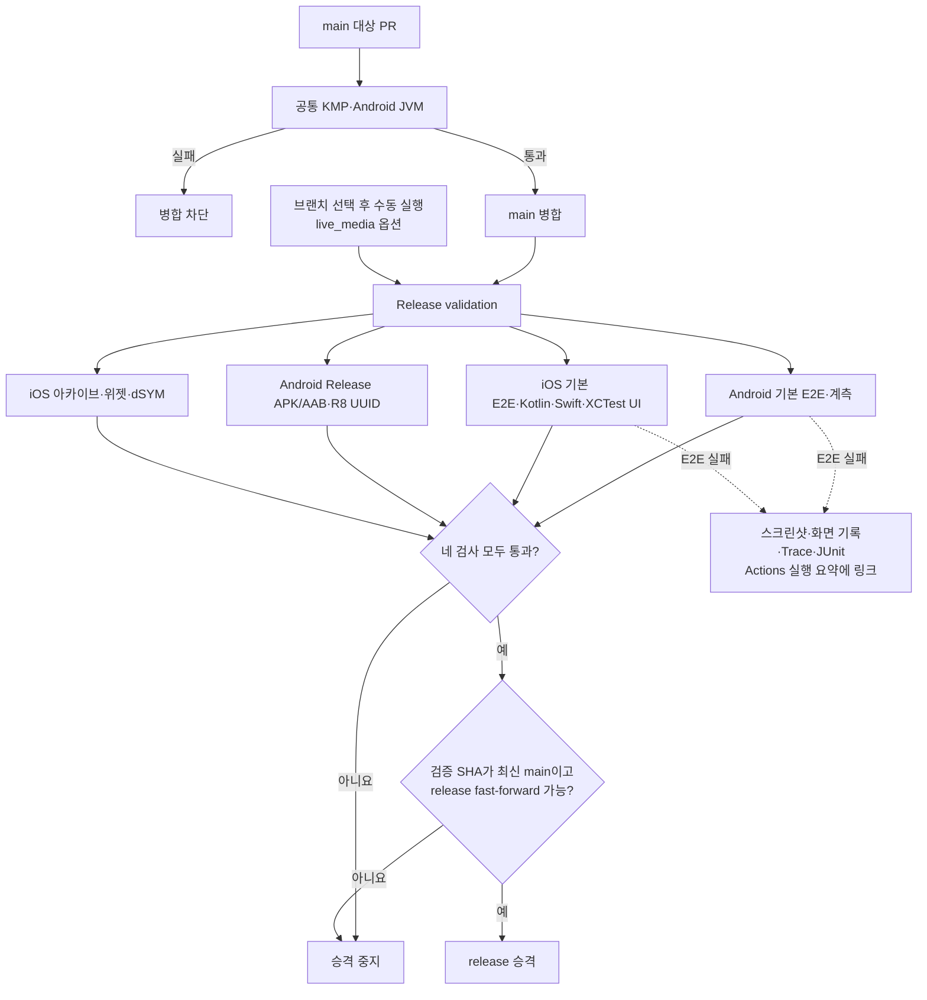

# 테스트와 release 승격

## GitHub 검사

| 시점 | 검사 | 실패하면 |
| --- | --- | --- |
| main 대상 PR 생성·새 커밋 반영·다시 열기 | JDK 21/Ubuntu 24.04에서 `:androidApp:testDebugUnitTest`와 `:shared:testAndroidHostTest` | 기존 main 필수 검사에서 병합 차단 |
| main push 또는 수동 실행 | Android 에뮬레이터와 iPhone 시뮬레이터에서 Tester Army, Android instrumentation, Kotlin iOS·Swift·XCTest UI | release 승격 차단 |
| 위 릴리스 검증과 병렬 | Android Release APK/AAB·R8/Sentry UUID, unsigned iOS archive·위젯·dSYM | release 승격 차단 |

main ruleset **22331611**의 필수 검사 이름 `Android build and unit tests`, `iOS build and unit tests`를 유지한다. 두 번째 이름은 기존 규칙과의 호환용이며 실행 내용은 공통 KMP와 Android adapter JVM 테스트다. release ruleset **25774154**에서 요구하는 `Android release build`, `iOS release build`도 유지한다. 시뮬레이터 검사까지 통과한 해당 SHA만 승격 작업에서 다룬다. PR 이벤트로만 실행하므로 PR 브랜치에 새 커밋을 올려도 검사가 한 번만 실행된다. 나중에 merge queue를 활성화하면 `merge_group` 이벤트를 추가한다.

승격은 `main`에서만 실행한다. 실행 중 main이 갱신되면 이전 실행은 push하지 않고 최신 실행에 맡긴다. 검증한 SHA가 release에서 fast-forward 되는 경우에만 일반 push한다. 승격 job에만 `contents: write`가 필요하며, GitHub Actions 토큰은 브랜치 규칙을 우회하지 않는다. PR 브랜치에 변경을 올린 뒤 Actions의 **Release validation → Run workflow**에서 그 브랜치를 선택하면 승격 없이 GitHub 실행 환경을 먼저 검증할 수 있다. release가 성공한 뒤에도 스토어 서명·제출은 별도 절차다.

## 실행 흐름



수동 실행에서 `live_media`를 켜면 양 플랫폼 E2E 작업에 배포 데모 강의 재생이 추가된다. 기본 자동 승격은 원격 MP4 응답에 의존하지 않는다. 수동 실행이 PR 브랜치를 대상으로 하면 검증만 수행한다.

## 테스트 정리 기준

기준 Native: `343abf53cd09978d54468d62700bd1f2c9fb7e79`. WebView 기준 소스: 원격 main `8f33e1241f142868d509ac52ed4ea5ccf654f627`, 로컬 동반 변경 `5834c25`. E2E는 앱이 실제 접속하는 배포 WebView를 테스트하며 해당 서비스의 배포 커밋을 고정하지 않는다.

- Android/JVM과 KMP: 인증 실패·저장소 이전·세션 만료·브리지 스키마와 권한·도메인 로직을 유지한다. 브랜치 검사에는 OS 기기, 외부 KLAS 계정, 배포 WebView를 넣지 않는다. GitHub 이미지에 포함된 Android SDK를 사용하며 Gradle 의존성은 다운로드할 수 있어야 한다.
- Android instrumentation: Compose의 키보드·레이아웃·설정 상태와 Keystore·위젯은 실제 OS 및 컴포넌트에 맞닿아 있어 유지한다. 샘플 산술·패키지명 테스트는 삭제했다.
- iOS XCTest: Swift와 Kotlin의 플랫폼 테스트는 시뮬레이터 쪽에 둔다. 앱의 WebKit·Keychain·WidgetKit·회전·Dynamic Type 검증은 유지한다. 원격 영상은 이미 명시적으로 켤 때만 테스트한다. 비동기 작업은 고정 시간 후 결과를 단정하는 대신 화면 상태·이벤트나 테스트가 제어하는 완료 신호를 기다린다.
- Reviewer 데모의 로그인은 기존 설계대로 일반 계정의 로그인 후 설정·약관 흐름을 생략한다. 해당 퍼널의 분기·동의·건너뛰기는 기존 플랫폼 테스트에서 별도로 확인한다.

## UI 검증 범위

| 시나리오 | 검증 위치 |
| --- | --- |
| 최초 실행·9자리 학번에서 다음 비활성·10자리에서 비밀번호 진입·인증 실패/성공·세션 복원·로그아웃 | 양 플랫폼 E2E. 자동 온보딩 스와이프는 포함하지 않는다. |
| 로그인 안내 시트 열기·닫기 및 학번 입력 복귀 | 양 플랫폼 E2E. Android Compose에는 링크 배치 검사를 유지한다. |
| 피드·시간표 탭 전환과 실제 WebView 데이터 표시 | 양 플랫폼 E2E. iOS는 가로 화면 표시와 세로 복귀 후 조작도 확인한다. |
| 학기 버튼 → 네이티브 시트 → 이전 학기 선택 → WebView 표시 변경 | 양 플랫폼 E2E. 데모의 현재·이전 학기는 가상 데이터를 사용한다. |
| 실제 데모 영상 재생·일시정지·10초 이동·학습 종료·목록 확인 | 양 플랫폼 E2E의 `live-media` 선택 검사. |
| 키보드 입력 및 큰 글자 크기의 시트·경고·다운로드 취소 | iOS XCTest UI. |
| 온보딩 배치와 스와이프, 짧은 로그인 화면, 위젯·Keystore·강의 교체·PiP | Android 계측. Compose 동기화와 상태·콜백을 사용한다. |

## 로컬에서 E2E 실행

Node 26과 테스트 전용 기기를 준비하고 Debug 앱을 설치한다. 시나리오 시작 시 앱 데이터를 초기화하므로 개인 계정이 들어 있는 기기에서 실행하지 않는다.

```sh
npm ci --prefix e2e
E2E_ANDROID_DEVICE=emulator-5554 npm test --prefix e2e -- --target android
E2E_IOS_DEVICE='SIMULATOR_UDID' npm test --prefix e2e -- --target ios
```

기본 CI 조합을 로컬에서 재현하려면 기기 변수를 지정하고 `bash e2e/run-ci.sh android` 또는 `bash e2e/run-ci.sh ios`를 실행한다. `npm test`는 기본 검사와 `live-media` 검사를 모두 실행한다. 영상만 다시 확인할 때는 `--tag live-media`를 붙인다.

실패하면 로컬의 `e2e/.e2e`를 확인한다. GitHub에서는 실행 요약의 링크나 **Artifacts**의 `e2e-android-failure-<회차>` / `e2e-ios-failure-<회차>`를 열 수 있다. JUnit·JSON 보고서, 실패 단계 추적과 드라이버가 캡처할 수 있었던 스크린샷·화면 요소가 들어 있으며 7일간 보관한다. 부팅이나 드라이버 연결 전에 실패하면 스크린샷이 없을 수 있다. PR 코멘트 권한은 필요하지 않다. 시나리오는 심사용 가상 데이터만 사용하고 자동으로 재시도하지 않는다.

로컬 검증(2026-11-18): Android 에뮬레이터에서 기본 E2E 4개 통과, iOS 시뮬레이터에서 기본 E2E 4개와 데모 영상 1개 통과. Android 데모 영상은 재생/일시정지까지 통과했으나 10초 뒤로 이동할 때 위치가 `00:00`으로 돌아가 탐색 검사에 실패했다. 배포 MP4는 byte range 요청에 `206 Partial Content` 대신 `200 OK`를 응답했다. 해당 응답이 Android 실패의 원인인지는 별도 확인이 필요하다.

배포 WebView 자체가 응답하지 않으면 main 병합은 가능하지만 release 승격은 멈춘다. 실계정 로그인, 추가 인증, 권한·위젯·PiP 실기기 검증 및 스토어 배포는 별도다. 복구가 필요하면 먼저 release workflow의 승격 job을 비활성화하거나 관련 PR을 되돌린다. release를 이미 승격했다면 강제 push 대신 수정 커밋을 main에 반영하고 검증 후 다시 승격한다.
